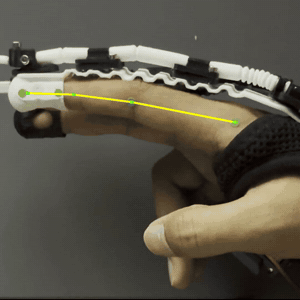
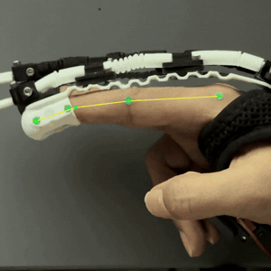
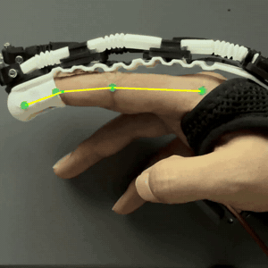

  

    
  

The exoskeleton worn during testing.

### Application

After a stroke or spinal cord injury, many people can no longer open and close their hand well enough to grasp everyday objects. A wearable exoskeleton can assist, but only if it fits the person, stays light enough to wear and is easy to control without long training.

  

    
  

Pilot test: a participant with stroke moving blocks with help from the exoskeleton.

---

### Research Question

*Can a hand exoskeleton be tailored to each user, made compact enough to wear, and controlled intuitively using the motor function that remains after injury?*

---

### Idea

**Personalised finger motion.** Each finger is driven by a single tendon, yet it has three joints, so where the motion goes depends on how stiff each joint is. Every joint combines two springs: the user's own finger, which stiffens as it bends, and a 3D-printed bellows structure on the glove whose stiffness is set by its geometry at fabrication. When the tendon pulls, the more compliant joints bend more and the stiffer ones bend less. Tracing those joint angles through the finger's link lengths gives the path of the fingertip.

The key insight is that the *shape* of that path depends only on the stiffness *ratios* between joints, while the overall stiffness sets how much force reaches the fingertip. So by measuring a user's hand dimensions and passive finger stiffness, the bellows can be designed to give each person a natural curling motion and the fingertip force they need.

  

    
    
MCP flexion

  

  

    
    
PIP flexion

  

  

    
    
All joints

  

Same tendon, different stiffness distributions: tuning the bellows moves flexion to the MCP joint, the PIP joint, or across all joints, so the fingertip trajectory can be designed for each user.

**A foldable rigid-chain actuator.** Bulky actuators are one of the main reasons hand exoskeletons stay in the lab. A custom 80 N rigid-chain actuator pushes and pulls like a rod but folds away when retracted, making it 49% more compact than the compared ball-screw design.

**Control from residual grip.** Even when movement is weak, people often keep some ability to squeeze. DEXTER reads this small isometric grip force and turns it into a command, so control feels natural and needs little training.

---

### System

  

    
  

Soft glove with bellows, finger caps and thumb splint (left), and the actuator module with circuit and battery (right). Click to zoom.

---

### Pilot Evaluation

The full 450 g system was pilot-tested for usability with four participants with chronic stroke.

---

### Significance

Personalisation, a compact actuator and control from residual grip together move hand exoskeletons closer to something people can use in daily life, not just in the clinic.

---

### Tools & Skills

Mechanical design · Tendon-driven actuation · Biomechanical modelling · Embedded control · Human-subject testing
