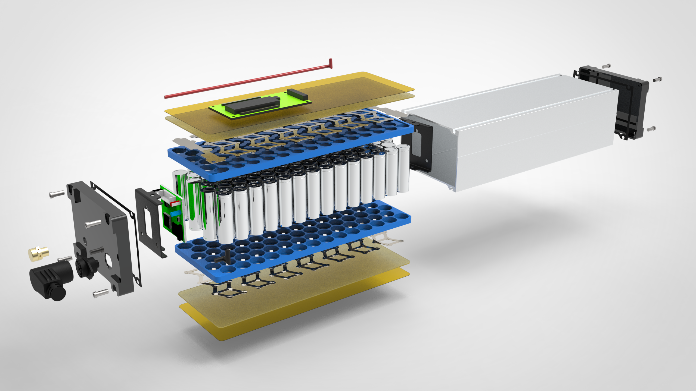
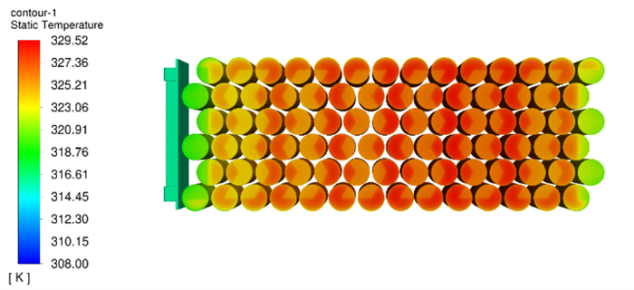
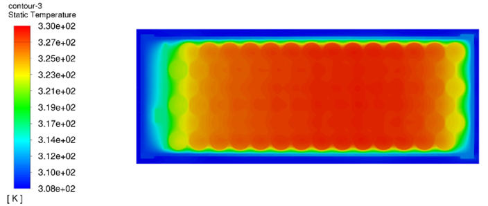
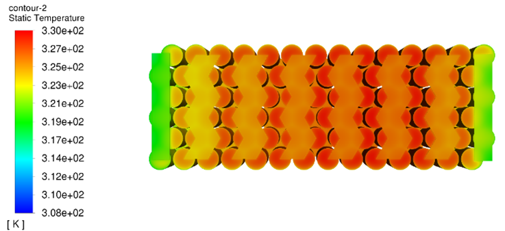
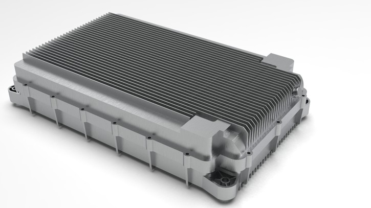
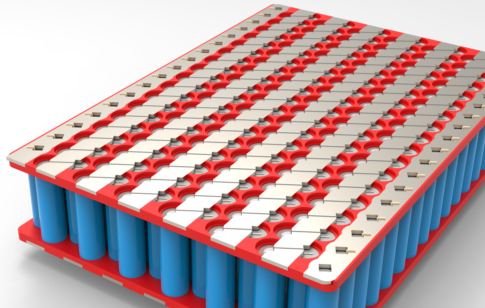
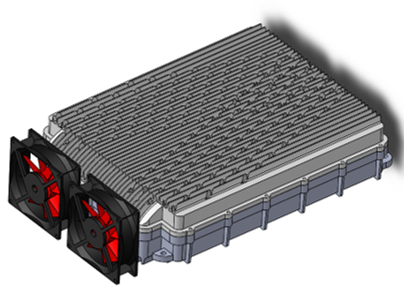

Exploded view of the modular battery pack.

### Overview

As an early engineer and battery team lead at Ebolt Mobility, an EV startup in Nepal, I designed, simulated, prototyped and tested a ~1.8 kWh lithium-ion pack for electric two-wheelers. The main challenge was heat: the pack had to run reliably in the hot Terai plains and under sustained load on hilly terrain.

| Specification | Value |
| --- | --- |
| Energy | ~1.8 kWh |
| Configuration | 14S6P lithium-ion |
| Nominal voltage | ~50 V |
| Continuous / peak current | ~30 A / ~90 A |
| Enclosure | Single modular aluminium unit, IP67 |

---

### Design

The layout was driven by packaging, airflow and structural strength as much as by electrical requirements.

- **Cells and bus bars:** parallel-grouped cells for even heat distribution, with nickel-strip bus bars sized for current sharing and reliable welds.
- **Cooling:** forced air channelled from the vehicle chassis. Inter-cell spacing was tuned to balance heat dissipation against pack size. Immersion cooling was also explored at concept level.
- **Safety:** BMS-based electrical protection and temperature sensing, an IP67-sealed enclosure, and pressure-relief valves for thermal events.

---

### Simulation (ANSYS)

[Multi-physics simulation](https://en.wikipedia.org/wiki/Multiphysics_simulation) guided each design iteration and cut down on physical prototypes. Cell-level models were built from HPPC test data, and the pack was modelled in ANSYS Fluent as a reduced-order model.

- **Thermal CFD:** effect of cell spacing, airflow velocity and thermal interface materials on peak cell temperature.
- **Electro-thermal:** bus-bar current density and Joule heating, including hot spots at the terminals.
- **Structural:** drop-test simulations and stress analysis of the enclosure and end plates.

  
  
  

Electro-thermal simulation results showing temperature distribution.

---

### Prototypes

Several prototype cycles shaped the final modular design, with each version improving assembly and thermal performance.

  
  
  

Early prototypes and test setups.

---

### Outcome

The final pack held a peak temperature of 52 °C at an 80% duty cycle in 38 °C ambient, and was successfully tested integrated with the vehicle powertrain.

---

### Tools & Skills

ANSYS (Thermal CFD, Structural, Electro-Thermal) · Battery pack mechanical design · Thermal validation · EV systems engineering
