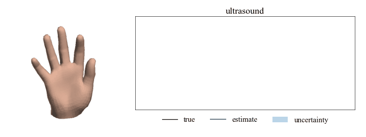

  

    
  

Estimated finger motion from ultrasound, EMG, and both together. The shaded band represents the model's uncertainty, which decreases as complementary sensory information is combined.

### Application

Prosthetic hands and exoskeletons need control signals that remain reliable in daily life. Wearable sensors can shift, be replaced with different devices, or fail. Conventional decoders are often trained for a specific sensor and placement, making them sensitive to changes in sensing conditions.

---

### Research Question

*Can a unified model learn a shared physical latent representation from ultrasound and EMG that enables robust hand-state estimation across changes in sensor placement, orientation, and configuration?*

---

### Idea

Inspired by the [Thousand Brains Theory](https://thousandbrains.org/), the model maintains a shared internal representation of the physical state of the hand and forearm. Each sensor, whether B-mode ultrasound, sparse wearable ultrasound, or EMG, acts as an independent module that contributes evidence to the shared state estimate. The model also quantifies uncertainty, allowing less reliable observations to carry less weight.

  

    
  

Multiple sensing modalities contribute to a shared physical state representation of hand posture, tissue deformation, and muscle activation for hand-motion decoding.

The physical state model captures the distribution of underlying physical states and how each sensor observes them:

$$
\mathbf{x} \sim \mathcal{N}\left(\boldsymbol{\mu}_0, \mathbf{P}_0\right), \qquad
\mathbf{c}_s = \mathbf{H}_s \mathbf{x} + \boldsymbol{\varepsilon}_s, \quad
\boldsymbol{\varepsilon}_s \sim \mathcal{N}\left(\mathbf{0}, \mathbf{R}_s\right)
$$

where $$\mathbf{x}$$ represents the underlying physical state, $$\mathbf{c}_s$$ represents the observations from sensor $$s$$, $$\mathbf{H}_s$$ describes its observation model, and $$\mathbf{R}_s$$ represents its measurement uncertainty.

Assuming conditionally independent sensor noise, Bayesian inference combines the available observations to estimate the shared physical state and its uncertainty:

$$
\mathbf{P}^{-1} = \mathbf{P}_0^{-1} + \sum_s \mathbf{H}_s^{\top} \mathbf{R}_s^{-1} \mathbf{H}_s
$$

Each reliable sensor contributes information to the shared state estimate. When a sensor becomes unavailable, the model continues inference using the remaining observations, with potentially increased uncertainty.

---

### Results

- Generalizes across ultrasound devices without retraining.
- Maintains state estimation under sensor dropout and failure.
- Adapts to new sensor placements with a few minutes of calibration while retaining previously learned knowledge.

*More details will follow after publication.*

---

### Significance

By decoupling the underlying physical state from the sensing modality and configuration, this approach aims to reduce dependence on specific sensors and repeated calibration, enabling more reliable control of wearable assistive devices.

---

### Tools & Skills

Ultrasound (B-mode, sparse) · EMG · Latent state modeling · Bayesian sensor fusion · Continual learning · Uncertainty estimation